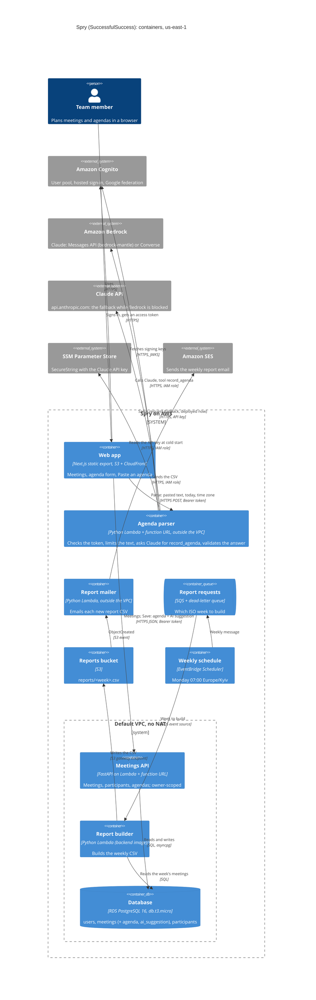
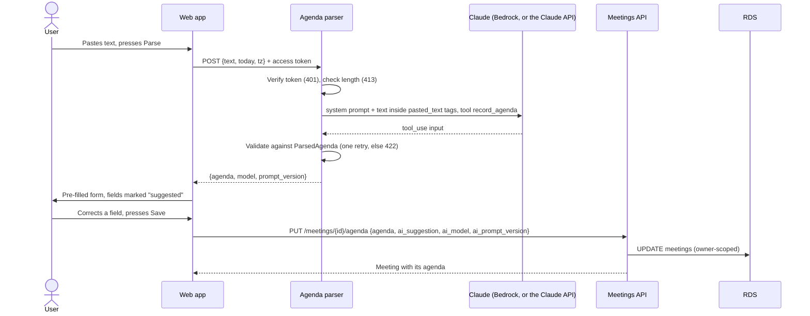

# Spry: container diagram (C4, level 2)

The whole system as deployed in `us-east-1`, including Lab 6's agenda parser. The
two Lab 6 paths are:

- **parse:** browser → agenda parser → Bedrock (for now the Claude API, the fallback
  while Bedrock is blocked for the account);
- **save:** browser → API → RDS.

The parser never writes. See [ADR 0006](../adr/0006-llm-agenda-parsing.md).

## Containers

| Container | Runs as | Lab | Notes |
| --- | --- | --- | --- |
| Web app | Static export in S3, served by CloudFront | 2, 4 | Gets Cognito tokens with Amplify; calls the API and the parser with the access token |
| Meetings API | Lambda (container image) + public function URL, in the VPC | 3, 4 | Checks the Cognito token itself; signing keys are passed in at deploy, since it has no internet |
| Database | RDS PostgreSQL 16, `db.t3.micro` | 4 | Reached only from the API's and the builder's security group. It is RDS, not Aurora |
| Agenda parser | Lambda (same image, handler `app.ai.agenda_lambda.handler`) + public function URL, **outside** the VPC | **6** | No database access. 401 without a token, 413 over 10,000 characters, one JSON log line per parse. Model set by `PARSER_PROVIDER` / `PARSER_MODEL`; deployed now: `anthropic_api` / `claude-opus-5-5`, key from SSM |
| Report builder | Lambda (same image), in the VPC | 5 | Triggered by SQS; writes to S3 through the gateway endpoint |
| Report mailer | Lambda (inline code), outside the VPC | 5 | Triggered by S3; sends through SES |
| Report requests | SQS queue + DLQ | 5 | Filled by the schedule and `make report-now` |

## The two Lab 6 paths

