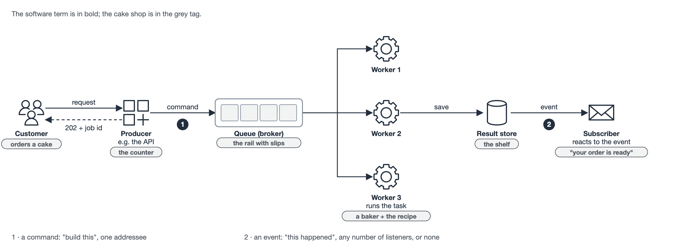
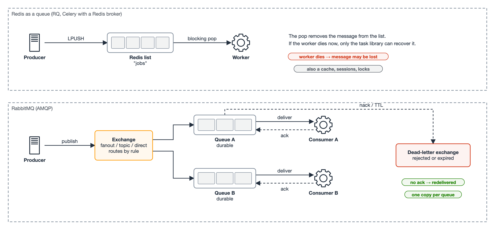
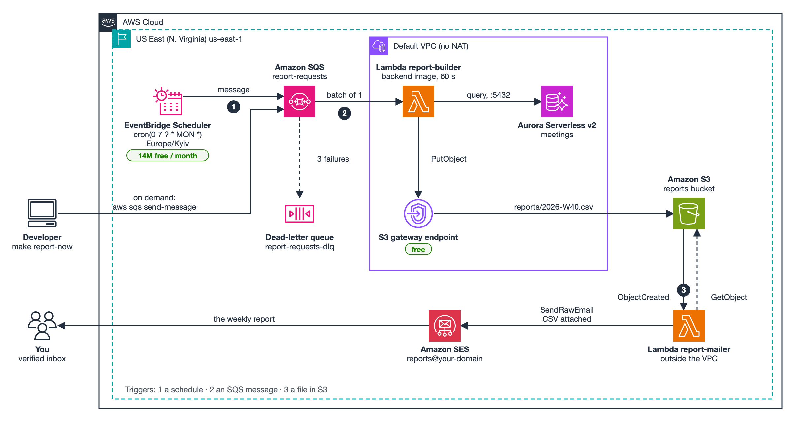
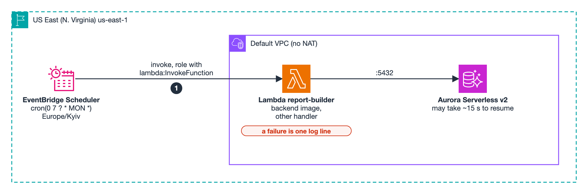

Lab 5. A weekly report, built by events
Початок приймання: четвер 1 жовтня 2026 00:00 AM
Термін спливає: четвер 15 жовтня 2026 23:55 PM
Until now, everything in your app has happened inside a request. The browser asks, the API answers, and the user waits for it. Some work should not happen like that. It takes too long, it has to happen when nobody is asking, or the person who started it should not have to wait.

In this lab you build one feature of that kind: a weekly meetings report. Every Monday morning, the system queries your database, saves the report as a file on S3 and emails it through Amazon SES. Nobody clicks anything.

You build it on AWS only: Lambda functions triggered by a schedule (EventBridge Scheduler), a queue message (SQS) and a file upload (S3). Before that, we look at how the same pattern is usually built without AWS, with Celery or RQ on Redis or RabbitMQ. Those are alternatives to know and compare. You do not deploy them in this lab.

What you submit
A link to the commit that adds the report: the report code, the infrastructure template and the two Lambda handlers.
A screenshot of the email that SES delivered to your real inbox, with the CSV attached.
The output of aws s3 ls s3://<your-reports-bucket>/reports/ --recursive, showing at least two reports: one built by the schedule and one built on demand with make report-now.
Three CloudWatch log lines, one for each trigger: the schedule, the SQS message and the S3 upload. Each line must show which event started the function.
Short written answers to the questions in Part 3, Step 7.
Part 1 — What "event-driven" means
The cake shop
A cake shop takes orders. A customer asks for a cake, the shop writes the order on a slip of paper, and pins the slip to a rail above the kitchen. The person at the counter does not bake anything. They take the next order straight away.

In the kitchen, bakers take slips from the rail one by one. Every slip names a recipe: "Napoleon, 8 portions, for Saturday". The baker does not invent anything. They follow the recipe with the parameters on the slip. When the cake is ready, it goes on the shelf, and someone calls the customer: "Your order is ready."

Now map it to software:

Cake shop	Software
The order slip	A message: what to do and with which parameters
The rail with slips	A queue (a broker: Redis, RabbitMQ, SQS)
The person at the counter	The producer: the API takes the request, puts a message on the queue, answers at once
The recipe	The task: a function in your code, build_weekly_report(week)
A baker	A worker: a process that takes messages and runs tasks
The shelf	The result store: a file on S3, a row in the database
"Your order is ready"	A new event, which can start the next step
The order number on the receipt	A job id: the customer can ask "is it ready?" without standing at the oven
The cake shop as software: a customer sends a request to a producer, which answers 202 with a job id and puts a command on a queue; three workers take messages one at a time, save the result, and the saved result produces an event for a subscriber

McDonald's
McDonald's is the same idea at scale. You order at a kiosk, and you get a number. The order appears on the kitchen screen. The grill, the fryer and the drinks station each see their own part of the order and work in parallel. Nobody at the grill knows or cares who ordered. When everything is assembled, your number appears on the big screen. That screen is a publish/subscribe channel: one event, many people watching, and only the one with that number reacts.

What this buys McDonald's:

The counter never blocks. A slow order does not stop the next customer from ordering.
The kitchen scales separately. At lunchtime they add people to the grill, not to the counter.
Failures stay local. If the fryer breaks, burgers still come out.
Peaks are absorbed. Twenty orders in one minute become a longer queue, not a crash.
What it costs:

You do not get the answer immediately. You get a promise and a number.
Things can happen twice. If the screen glitches and shows an order again, will the kitchen make a second burger? In software, most queues deliver at least once. Your task has to cope with running twice.
Order is not guaranteed. The person who ordered after you may get their food first.
It is harder to see what is going on. "Where is my order?" now has five possible answers.
Events and commands
Two kinds of messages travel through such a system, and the difference matters:

A command asks for something to happen: BuildWeeklyReport(week=2026-W40). It has one addressee and can be refused.
An event says that something already happened: ReportCreated(key=reports/2026-W40.csv). It is a fact in the past tense. The sender does not know who listens, and there can be any number of listeners, or none.
In this lab, the schedule sends a command. S3 saving the file produces an event. The mailer reacts to that event, and the builder does not know the mailer exists. That is the part that makes the architecture event-driven: you could add a second listener (for example, one that posts to Slack) without touching the builder at all.

Part 2 — The same pattern without AWS: the alternatives
This part is reading and discussion, not something you deploy. Outside a cloud, or when you do not want to depend on one, the same pattern is built from two pieces: a broker that holds the messages, and a task library that turns Python functions into messages and back. You will meet these in most Python projects, so know what they are and when you would pick them over the AWS services.

Two brokers: Redis and RabbitMQ
Redis	RabbitMQ
What it is	An in-memory data store. A queue is one of the things you can build with it (a list, or a stream)	A message broker and nothing else. It speaks AMQP
How a message is delivered	LPUSH adds to a list, a worker takes it with a blocking pop. Once taken, it is gone from the list	The broker hands the message to a consumer and waits for an ack. Without the ack, it delivers the message again
When a worker dies mid-task	Depends on the library. The message is already out of the list, so the library has to track it and recover it	The connection drops, the message was not acked, and RabbitMQ returns it to the queue
Routing	None built in: one list is one queue	Exchanges: direct, topic and fanout. One message can go to many queues by rule
Publish/subscribe	Pub/Sub exists, but a subscriber that is offline misses the message	A fanout exchange with durable queues: each subscriber gets its own copy, even if it was offline
Failed messages	Up to the library	Dead-letter exchanges, TTLs, priorities, out of the box
Durability	Optional: RDB snapshots or AOF. In many setups, a restart loses data	Durable queues and persistent messages are written to disk
What else it does	Cache, sessions, rate limits, locks. You probably need it anyway	Nothing else. One more service to run
The short version: Redis is a fast data structure that can be used as a queue. RabbitMQ is a queue that was designed to not lose messages. For background jobs in a small app, Redis is usually enough. When several services exchange events, and losing one is a bug, RabbitMQ (or a managed queue such as SQS) is the better fit.

Redis: a producer pushes onto a list and a worker pops it, so the message leaves the list before the work is done. RabbitMQ: a producer publishes to an exchange that routes copies into durable queues; consumers ack each message, unacked messages are redelivered, and rejected or expired ones go to a dead-letter exchange

Two task libraries: Celery and RQ
Celery	RQ (Redis Queue)
Brokers	RabbitMQ, Redis, SQS and others	Redis only
Size	Large: many features, many settings	Small: you can read its source in an evening
Message format	JSON by default, with its own protocol	A pickled Python call: function path and arguments
Retries	autoretry_for, retry_backoff, max_retries	Retry(max=3, interval=[10, 30, 60])
Delivery after a crash	With acks_late=True, the message is redelivered	The job lands in a failed or abandoned registry. You re-queue it yourself
Repeating schedules	Celery beat, a separate process: crontab(day_of_week="mon", hour=7)	Only one-off delays: enqueue_in, enqueue_at. Repeating schedules need rq-scheduler or plain cron
Workflows	chain, group, chord: pipelines of tasks	depends_on: a job waits for another job
Monitoring	Flower	rq info, rq-dashboard
Workers in other languages	Possible through the protocol	Python only, because the message is a pickled Python call
Celery is the default choice when a project already has a lot of background work. RQ is the choice when you want the idea without the configuration. In class we use RQ to show the pattern in a few lines, because it has very little in the way.

The same roles, different tools
Role	Self-hosted alternatives	AWS service
Something that fires on a schedule	cron, Celery beat, rq-scheduler	EventBridge Scheduler
A queue that holds commands	a Redis list, a RabbitMQ queue	SQS, with a dead-letter queue
A worker that runs the task	a Celery or RQ worker process	a Lambda function with an event source
A place for the result	a disk, a database	S3, a database
Publish/subscribe for events	Redis Pub/Sub, a RabbitMQ fanout exchange	SNS, EventBridge, S3 event notifications
Sending email	an SMTP server	Amazon SES
Every row is the same role played by a different technology. This is why the patterns matter more than the tools. The difference is who runs it: with the left column, you run the broker and the workers yourself and pay for them while they wait; with the right one, AWS runs them and bills per use.

What RQ looks like (theory, not part of the lab)
To see how little the pattern needs, here is the cake shop in RQ. The recipe is an ordinary function:

# recipes.py
def bake(cake: str, portions: int) -> str:
    ...                                  # takes a while
    return f"{cake} for {portions} is on the shelf"
The counter does not bake. It puts the order on the queue and gives the customer a number:

from redis import Redis
from rq import Queue, Retry

orders = Queue("orders", connection=Redis())
job = orders.enqueue("recipes.bake", "Napoleon", 8,
                     job_timeout=600, retry=Retry(max=3, interval=[10, 30, 60]))
print(job.id)              # the order number
print(job.get_status())    # queued → started → finished (or failed)
A baker is a separate process, started with rq worker orders. Start three, and three cakes are baked in parallel. In a web app, the counter is the API: it answers 202 Accepted with the job id, which means "I took your order, I have not done it."

What to notice:

Stop all workers and enqueue three orders. They wait in Redis. Start a worker, and all three run.
If the task raises, RQ retries it three times, then moves it to the failed registry (rq info).
If a worker is killed in the middle of a task, the job does not come back by itself. Compare with RabbitMQ's acks in the table above, and with SQS's visibility timeout in Part 3.
"Bake a cake every Monday" is not something RQ can do alone: it needs rq-scheduler, cron or Celery beat. On AWS, that is EventBridge Scheduler.
The same in Celery is a @app.task decorator on bake, bake.delay("Napoleon", 8) to enqueue, and celery -A recipes worker to start a baker, with Redis or RabbitMQ as the broker.

Part 3 — The lab: the weekly report on AWS
The target architecture:

Target: EventBridge Scheduler and make report-now send messages to an SQS queue with a dead-letter queue; the report-builder Lambda in the VPC reads Aurora and writes the CSV to S3 through a gateway endpoint; ObjectCreated triggers the report-mailer Lambda outside the VPC, which reads the file and sends it through SES to your inbox

Why two functions and not one? Remember Lab 4: the backend Lambda is in the VPC so that it can reach Aurora, and there is no NAT gateway, so it cannot reach anything else on the internet. SES is on the internet. So:

The builder stays in the VPC. It reaches Aurora directly and reaches S3 through a gateway VPC endpoint, which is free.
The mailer runs outside the VPC. It has normal internet access, reaches SES, and never touches the database.
They are connected by an event: a file appearing in S3. Neither function calls the other.
The constraint from Lab 4 pushed the design towards events. That happens often.

Put everything in one new CloudFormation template, for example infra/reports.yml, tagged with your PROJECT_NAME like the rest.

Step 1 — The report itself (~10 min)
Write a plain function, with no AWS in it yet, in backend/app/reports/weekly.py:

def build_weekly_report(week: str) -> bytes:
    """Query the meetings of one ISO week (e.g. "2026-W40") and return the CSV."""
What goes in the report depends on your data. At a minimum:

the number of meetings in that ISO week and their total duration in hours;
the same two numbers for the week before, and the change;
the five longest meetings: title, start, duration and number of participants.
If your schema has organisers or members, break the totals down per person. That is the Spry "Insights this week" screen, as a file.

Two rules that the rest of the lab relies on:

The week is a parameter. The function never says "last week" internally. Whoever calls it decides which week. You will need that to rebuild an old report.
The same week always produces the same file name, for example reports/2026-W40.csv. Running the function twice for one week overwrites one file, and does not create two. This makes the task idempotent, which is what makes "at least once" delivery harmless.
Test it locally against your compose database before putting it in a Lambda. A function that only works inside AWS is a function you can only debug by deploying.

Step 2 — The bucket and the S3 endpoint (~10 min)
AWS::S3::Bucket, private, with a lifecycle rule that deletes reports after 90 days. Name it explicitly, for example !Sub ${ProjectName}-reports-${AWS::AccountId}. You will see why in Step 5.
AWS::EC2::VPCEndpoint of type Gateway for com.amazonaws.us-east-1.s3, attached to the route tables of the subnets your Lambda functions use. Without it, the builder's PutObject hangs until the timeout, because the request has nowhere to go.
Step 3 — Trigger 1: a schedule (~20 min)
Start with the simplest version: the schedule invokes the builder directly, with no queue.

Step 3: EventBridge Scheduler invokes the report-builder Lambda directly, and the builder queries Aurora; a failure is only a log line

The builder function. Reuse the backend's container image, with a different handler: ImageConfig: { Command: ["app.reports.lambda_handler.handler"] }. It gets your models, your database code and your build_weekly_report for free. Same VPC, security group and environment as the API. Timeout: at least 60 seconds, because Aurora may need ~15 seconds to resume.
AWS::Scheduler::Schedule:
ScheduleExpression: cron(0 7 ? * MON *)
ScheduleExpressionTimezone: Europe/Kyiv. Without it, the cron runs in UTC, and the report arrives at 9 or 10 o'clock depending on daylight saving time.
FlexibleTimeWindow: { Mode: "OFF" }
Target: the builder's ARN, a role that EventBridge Scheduler assumes and that is allowed lambda:InvokeFunction, and an Input with the payload, for example {"source": "schedule"}.
The handler decides the week: if the event has no week, it takes the previous ISO week.
Test it without waiting for Monday. Temporarily set the expression to rate(5 minutes), or invoke the function by hand with the same payload. Then set it back.

Log the event at the start of every handler, for example:

log.info("report-builder triggered", extra={"trigger": detect_trigger(event), "week": week})
That line is what you submit for item 5.

Step 4 — Trigger 2: an SQS message (~20 min)
Now put a queue between the schedule and the function, as on the diagram.

AWS::SQS::Queue report-requests:
VisibilityTimeout at least 6 times the builder's timeout. If a message becomes visible again while the first attempt is still running, a second builder starts on the same report.
RedrivePolicy: after maxReceiveCount: 3, the message moves to report-requests-dlq.
AWS::Lambda::EventSourceMapping from the queue to the builder, BatchSize: 1.
Change the schedule's target to the queue, with sqs:SendMessage permission on its role. The schedule now sends a message with {"week": null, "source": "schedule"}.
Add make report-now WEEK=2026-W39, which sends a message with aws sqs send-message. This is how you rebuild an old report, and it is your on-demand report for item 4.
The builder's handler now receives an SQS event, with the payload in event["Records"][0]["body"]. Handle both shapes: a direct invocation and an SQS record.

Why bother with the queue, when the schedule could call the function directly?

Retries and a dead-letter queue. If Aurora is slow to resume and the first attempt times out, the message comes back, and after three failures it waits in the DLQ instead of disappearing. With a direct invocation, a failure is a log line nobody reads.
Backpressure. New accounts have a Lambda concurrency limit of 10. A hundred report requests at once wait in the queue instead of being throttled.
One entry point. The schedule, the Makefile and, later, the API all send the same message. The builder does not care who asked.
Note that the builder is in a VPC with no NAT, and it still receives SQS messages. The Lambda service polls the queue and invokes your function. Your function never connects to SQS.

Step 5 — Trigger 3: a file in S3 (~25 min)
The mailer function: Python, not in a VPC. Small enough to keep its code inline in the template, or in a zip. Its role may call s3:GetObject on the reports prefix and ses:SendRawEmail.
The S3 notification: NotificationConfiguration.LambdaConfigurations on the bucket, event s3:ObjectCreated:*, filtered to the prefix reports/ and the suffix .csv.
AWS::Lambda::Permission that allows s3.amazonaws.com to invoke the mailer, with SourceArn set to the bucket's ARN and SourceAccount to your account.
Here is the reason for the explicit bucket name. The bucket needs the permission to exist before it can add the notification, and the permission needs the bucket's ARN. With !GetAtt Bucket.Arn, CloudFormation reports a circular dependency. With a name you construct, the permission's ARN is !Sub arn:aws:s3:::${ProjectName}-reports-${AWS::AccountId}, and the bucket simply DependsOn the permission.

The mailer reads the bucket and the key from event["Records"][0]["s3"], downloads the file and sends it as an attachment. Build the message with Python's email.message.EmailMessage and send it with sesv2.send_email(Content={"Raw": {"Data": msg.as_bytes()}}).

Never let the mailer write into reports/. A function that is triggered by uploads to a prefix and uploads to the same prefix calls itself forever, and bills you for every call.

Step 6 — SES (~15 min)
AWS::SES::EmailIdentity for your domain. It outputs three DKIM tokens. Add them as CNAME records at your DNS provider, the same way you validated the certificate in Lab 4. The status becomes Verified after a few minutes.
The sandbox. A new account's SES can only send to verified addresses, at most 200 emails a day. Verify your own email as a second identity, and send the report there. For a lab, that is enough. A real product requests production access, which AWS reviews by hand.
The sender is reports@<your domain>, and the recipient list comes from an environment variable or an SSM parameter, not from the code.
Step 7 — Check it end to end, and answer (~15 min)
Run make report-now WEEK=<last week>. Within a minute: a new object in S3, a log line from the builder with trigger=sqs, a log line from the mailer with trigger=s3, and an email in your inbox. Screenshot the email.
Let the schedule fire, or set it to rate(5 minutes) for one run. Find the builder's log line with trigger=schedule.
Break it: make the builder raise for one specific week. Send that week, and watch the message arrive in the DLQ after three attempts. Then fix the code and move the message back with Start DLQ redrive in the SQS console.
Send the same week twice. How many emails do you get? Write down why.
Answer in your submission:

The mailer got the same ObjectCreated event twice, and the person got two identical emails. Where would you store "this report was already sent", and what would the key be?
The builder in the VPC could not reach SES. List three ways to fix that, with their monthly cost: a NAT gateway, a VPC interface endpoint for SES, and the split you built. Which would you choose with ten more emails a week? With a million?
You could send a presigned S3 link instead of an attachment. A presigned URL signed with a Lambda role's temporary credentials stops working when those credentials expire, often within hours. How would you send a link that works for a week?
Stretch — a button in the app
Add a Send me this week's report button. The API is in the VPC with no NAT, so it cannot call sqs:SendMessage. Pick one of these, implement it, and justify the choice in a paragraph:

An SQS interface endpoint in the VPC: simple, but billed per hour and per availability zone.
A transactional outbox: the API writes a row to a report_requests table in the same transaction as everything else, and the builder, or a scheduled poller, picks rows up. No new network path, and the request is never lost even if the queue is down.
A request file: the API writes requests/<id>.json to S3 through the gateway endpoint, and a third trigger on that prefix sends the SQS message. Free, but is it a good idea?
What we discuss in class
Bring answers to these.

The pattern
In the cake shop, what is the command and what is the event? Find both in your lab.
McDonald's returns a receipt number at once. A web API does the same with 202 and a job id. What does the user see while the job is running, and what should they see if it fails?
"At least once" means your task can run twice. Which of your steps are idempotent, and which are not? (Hint: writing reports/2026-W40.csv versus sending an email.)
The report reads the database at 07:00 on Monday. A meeting from last week is edited at 07:01. Is the report wrong? What does eventual consistency mean for a weekly report, and for the Spry requirement of "recomputed within 5 minutes of a calendar change"?
You want to add a Slack notification when a report is ready. What do you change in the builder? (The right answer is "nothing". Explain why.)
The self-hosted alternatives
A payment service sends an event for every successful payment, and losing one means a customer paid for nothing. Redis or RabbitMQ? Justify with the table in Part 2.
RQ stores the job as a pickled Python call. What happens to the jobs in the queue when you rename the task function and deploy? What does that tell you about message formats between services?
Celery beat runs schedules in a separate process. What happens if you run two copies of it? What is the AWS equivalent of beat, and why does it not have this problem?
AWS
Why does the schedule send a message to SQS instead of invoking the function directly? Name a case where invoking directly is the better choice.
Why must the SQS visibility timeout be longer than the function timeout? Describe exactly what goes wrong if it is shorter.
A message lands in the DLQ on Sunday night. Who finds out, and how? Design the alarm.
The builder wakes Aurora up every Monday. What does that cost per month, using the numbers from Lab 4? What would it cost if the builder ran every five minutes instead?
EventBridge Scheduler, SQS and S3 notifications are each nearly free at this volume. SES is $0.10 per thousand emails. At what point does this design start to cost money, and which part first?
Умови завершення:
Зробити:Здайте роботу

